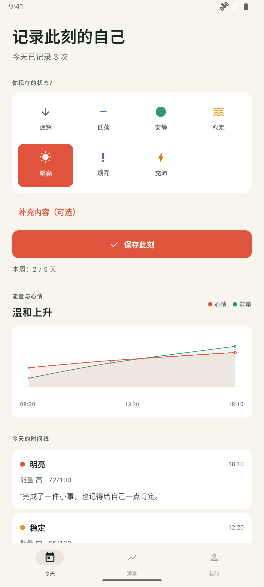
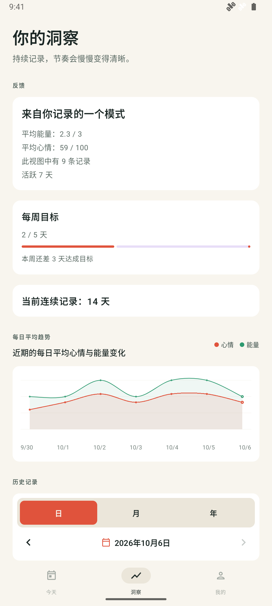
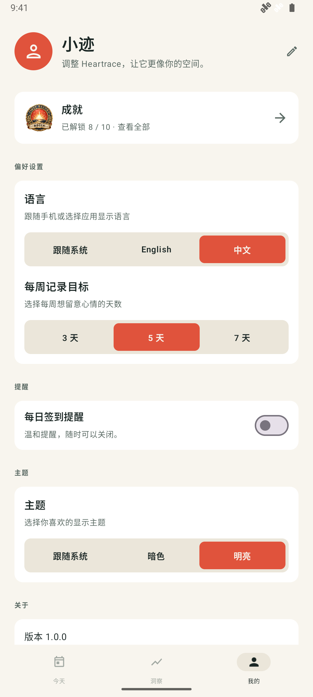
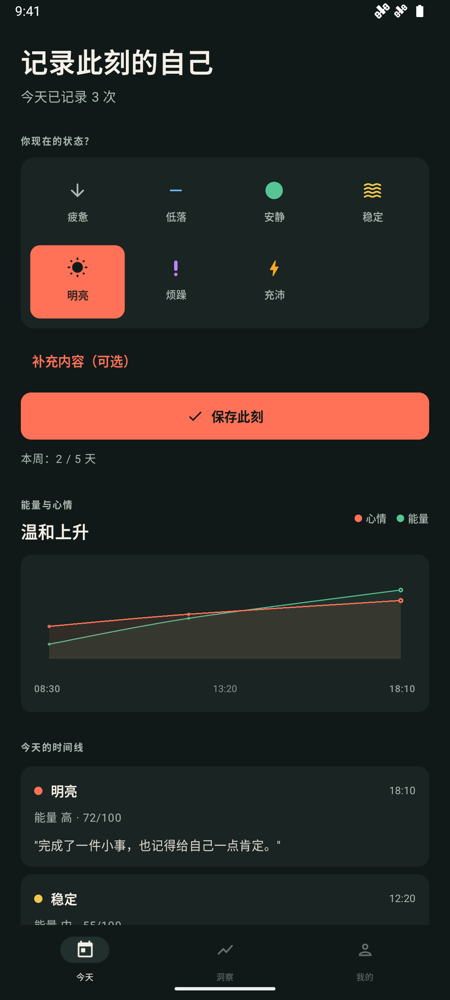
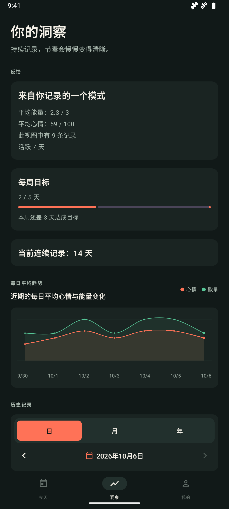
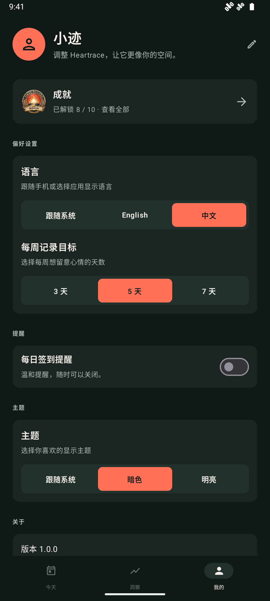

# Heartrace · 心迹

[English](README.md) | [简体中文](README.zh-CN.md)

心迹是一款以本地存储为核心的 Android 心情记录应用。用几秒钟留意当下的心情，写下值得记住的小事，再通过自己的记录，慢慢看见生活中的节奏。

无需注册账号或连接网络服务，即可记录心情、保存时刻和查看洞察。

## 应用截图

以下截图来自 Android 模拟器，使用中文界面与示例记录，不包含真实个人数据。第一行为明亮主题，第二行为暗色主题。

| 今天 | 洞察 | 我的 |
| :---: | :---: | :---: |
|  |  |  |
|  |  |  |

## 主要功能

- **今天**：从七种心情中选择当前状态，支持一天多次签到，也可以补充能量等级。
- **时刻记录**：为签到添加文字、多张图片和语音笔记，支持编辑记录的日期与时间。
- **洞察**：按日、月、年回顾历史，查看心情与能量趋势、活跃天数、每周目标和连续记录天数。
- **成就**：随着记录积累，解锁连续记录、每周目标和自我探索等徽章。
- **我的**：编辑昵称与头像，设置每周记录目标、每日提醒、语言和主题，或重置今天的记录。
- **语言与外观**：支持中文、英文及跟随系统语言；支持明亮、暗色及跟随系统主题，适配手机和大屏布局。
- **每日提醒**：通过 Android 闹钟安排签到通知，可随时关闭。

## 技术栈

- Kotlin、Jetpack Compose 与 Material 3
- Room、Kotlin Coroutines / Flow
- Hilt 依赖注入
- KSP 代码生成
- AndroidX Navigation 3
- Gradle Version Catalog 与 Gradle Wrapper

应用采用单 Activity 与 Compose 导航架构。页面 ViewModel 通过 `HeartraceDataSource` 访问数据，`HeartraceRepository` 统一协调 Room 持久化、附件清理、偏好设置和提醒调度。

## 项目结构

```text
app/       应用入口、Manifest、签名配置与界面集成测试
core/      数据模型、数据访问契约、Room 数据库、仓库与提醒调度
feature/   Compose 页面、ViewModel、界面状态、导航与功能测试
uikit/     共用组件、主题、附件处理与中英文资源
docs/      开发说明、测试文档与应用截图
```

Kotlin 源码位于各模块的 `src/main/kotlin`，JVM 测试位于 `src/test/kotlin`，设备测试位于 `src/androidTest/kotlin`。

## 开发环境

- Android Studio 与 Android SDK Platform 37
- Android Studio 自带的 JDK；当前构建已在 JDK 21 下验证
- Android 11（API 30）或更高版本的设备或模拟器

项目的 `compileSdk` 与 `targetSdk` 均为 37，`minSdk` 为 30，应用 ID 为 `me.heartrace`。Java 源码与目标字节码兼容级别为 11，这与运行 Gradle 所需的 JDK 版本是不同的设置。

## 构建与运行

使用 Android Studio 打开仓库根目录，完成 Gradle 同步并配置 SDK 路径，然后在设备或模拟器上运行 `app`。

也可以在仓库根目录使用 Gradle Wrapper 构建调试包：

```bash
# Linux / macOS
./gradlew :app:assembleDebug
```

```powershell
# Windows PowerShell
.\gradlew.bat :app:assembleDebug
```

APK 输出到 `app/build/outputs/apk/debug/app-debug.apk`。调试构建使用仓库中的测试签名密钥。

## 测试与检查

```bash
./gradlew :app:compileDebugKotlin
./gradlew :feature:testDebugUnitTest :app:testDebugUnitTest
./gradlew spotlessCheck
```

主要 JVM 测试位于 `feature` 模块，`app` 模块目前没有 JVM 测试源码，因此需要包含 `:feature:testDebugUnitTest` 才能运行页面状态与导航逻辑测试。

连接设备或模拟器后，可运行 Room 与 Compose 集成测试：

```bash
./gradlew :core:connectedDebugAndroidTest :app:connectedDebugAndroidTest
```

Windows 下将 `./gradlew` 替换为 `.\gradlew.bat`。测试范围与可选的 JaCoCo 覆盖率任务见 [测试文档](docs/testing.md)。

## 数据存储与权限

心情、时刻和偏好设置保存在应用私有的 Room 数据库 `heartrace.db` 中，当前数据库版本为 6：

- `MoodEntryEntity`：每次签到的心情、可选能量等级与时间。
- `DailyNoteEntity`：文字、图片与语音附件，可与一次签到关联。
- `AppStateEntity`：语言、主题、提醒、昵称、头像与每周目标等设置。

导入的图片、录制的语音和头像会复制到应用私有的 `files/attachments` 目录。应用没有实现自己的远程备份或同步服务；Manifest 已允许 Android 系统备份，实际备份行为取决于系统及用户设置。卸载前请留意本地数据的保留情况。

录制语音时会请求麦克风权限；Android 13 及以上版本启用提醒时会请求通知权限。

## 正式签名

未提供正式签名配置时，`release` 构建会回退到测试密钥。正式发布前需配置自己的签名：

1. 将 `keystore.properties.example` 复制为 `keystore.properties`。
2. 填写 `storeFile`、`storePassword`、`keyAlias` 和 `keyPassword`。
3. 将私有密钥与签名配置保留在版本控制之外，并妥善备份。
4. 执行构建命令：

```bash
./gradlew :app:assembleRelease
```

发布构建启用代码压缩与资源压缩。测试密钥仅用于本地开发，不应用于正式发布。

## 本地化与主题开发

界面文案位于 `uikit/src/main/res/values/strings.xml` 与 `uikit/src/main/res/values-zh/strings.xml`；提醒通知文案位于 `core` 模块对应的资源目录。新增文案时需同时维护中文与英文资源。

共用主题位于 `uikit/src/main/kotlin/me/heartrace/ui/theme/Theme.kt`。组件通过 `HeartraceTheme.colors`、`MaterialTheme.colorScheme` 或已有颜色别名读取配色，以兼容明亮与暗色主题。

## 许可证

仓库目前尚未声明开源许可证。
